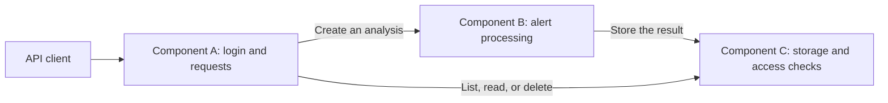

# Software Security Assignment I — Alert-analysis prototype

This Python/Django application accepts an invented test alert from an
intrusion detection system (IDS). It checks the data, produces a short
development summary, and stores the result for the user who submitted it.
Users can log in, create, list, and read analyses. Only an administrator
can delete them.

Three services run as separate programs and communicate using HTTP:

- Component A checks logins and sends requests to the other services.
- Component B checks the alert and produces the result using the installed
  `alert-helper` package.
- Component C stores results and checks who may access them.

Creating an analysis uses all three services. The database stores records,
and the helper is an installed Python package. Neither is an extra service.

Read [How to run](docs/How_To_Run.md) for commands,
[Design](docs/Design.md) for the explanation, and
[Terminology](docs/Terminology.md) for technical words in plain English.

## Architecture



Each component runs as a separate process and communicates over HTTP.
Creating an analysis uses component A, component B, and component C.
Listing, reading, and deleting go from component A directly to component C.
Responses return through the components that handled the request.

## Versions and results

| Branch | Purpose | Current verification result |
|---|---|---|
| `assignment-work` | Corrected application and current documents | Ten HTTP tests and one direct SQL test pass. Jenkins displayed build #12 as successful. |
| `fixed-version` | Corrected version used for comparison | Ten HTTP tests and one direct SQL test pass. Jenkins displayed build #6 as successful. |
| `main` | Corrected release branch | Jenkins displayed build #1 as successful. |
| `vulnerable-version` | Version with four deliberately enabled security flaws | Four HTTP tests and one direct SQL test fail where they check the broken protections. Jenkins build #5 is blocked as intended. |
| `experiment-composition-isolated` | Supplementary experiment with only the composition flaw enabled | Nine ordinary HTTP tests pass and only the owner-field test fails. Jenkins build #1 is blocked as intended. |

The [evidence index](docs/evidence/jenkins/README.md) links the saved reports.
Bandit finds unsafe SQL construction (B608/CWE-89) in the vulnerable version.
Both versions have a B105 warning for `Bearer`. It is a false positive:
the word names the token scheme and is not a password.
The saved dependency audits found no known vulnerabilities in the packages
they checked at that time.

The updated pipeline checks command results and approved package versions.
HTTP tests use separate automatically allocated ports. These changes have
local test evidence and current Jenkins runs. The [evidence index](docs/evidence/jenkins/README.md)
separates historical reports, local checks, and Jenkins build records.

## Four vulnerabilities and their fixes

The vulnerable branch enables three selected weaknesses and one additional
flaw caused by how the components work together. The corrected branches
keep the protections below active.

| Vulnerability | What goes wrong | Fix in the corrected version |
|---|---|---|
| CWE-20 — missing input-size check | Component B accepts alerts above the intended processing limit. | Reject alert JSON larger than 65,536 bytes with HTTP 413. |
| CWE-862 — missing ownership check | Bob can read an analysis owned by Alice. | Component C allows reads only for the owner or an administrator. |
| CWE-89 — SQL injection | An ID inserted directly into an SQL query can change what the query returns. | Pass the ID as an SQL parameter instead of inserting it into query text. |
| Composition flaw, CWE-807 — trusting a request's owner field | Component C accepts an owner chosen in the body even though component A's signed token names the authorized user. | Reject the extra owner field and store the user ID from the verified token. |

The SQL experiment has two complementary checks. The direct SQL test isolates
the storage query. The HTTP test sends an injected analysis ID through
Component A and Component C. On the vulnerable branch, the GET experiment
allows that input to reach the unsafe query. On the corrected branches, the
ID format check rejects it before the query runs. The HTTP test uses Alice's
own record, so it does not depend on the separate missing ownership check.
The [isolated composition experiment](docs/Composition_Isolation.md) shows
the wrong-owner write while read ownership checks remain active. Bob cannot
read Alice's ordinary record, but he can read the new record wrongly assigned
to him using a permission for Alice. The corrected version rejects that write.
See the [experiment guide](docs/Vulnerability_Experiments_Guide.md) for inputs,
code changes, and the corresponding test results.

## Setup — Windows PowerShell and Python 3.12

Run commands in the folder containing `manage.py`, `Jenkinsfile`, and
`requirements.txt`. In the extracted workspace this is the inner
`software-security-v1/software-security-v1` folder.

For a fresh clone, with access to the private repository:

```powershell
git clone --branch assignment-work https://github.com/sandrafosssoerensen/softwaresecurity-assignment1.git
cd softwaresecurity-assignment1
```

If you already have the repository, use that copy. Keep the full Git history.
A source ZIP downloaded from GitHub does not include the `.git` folder.

Create a virtual environment, install packages, build/install the helper,
and create test accounts:

```powershell
py -3.12 -m venv .venv
.\.venv\Scripts\python.exe -m pip install -r requirements.txt -r requirements-build.txt
.\.venv\Scripts\python.exe -m build --wheel --no-isolation helper
.\.venv\Scripts\python.exe -m pip install --no-deps helper\dist\alert_helper-0.1.0-py3-none-any.whl
.\.venv\Scripts\python.exe scripts\setup_lab.py
```

A virtual environment keeps this project's Python packages separate.
If the Windows `py` launcher is unavailable, check that
`python --version` shows Python 3.12 and use
`python -m venv .venv` instead.

The project-owned package is `alert-helper==0.1.0`, described in
[helper/pyproject.toml](helper/pyproject.toml). It is installed as a wheel,
an installable Python package file. Component B uses its functions to select and
check alert fields. Component A and component C also use its checks through the shared views.

Setup creates `alice` and `bob` as ordinary users and `admin` as the
administrator. All have the synthetic lab password
`Lab-only-Password-123!`. It also creates the signing keys and component A's user
database. Running setup again resets the test passwords but does not delete
component C's stored analyses. Keys and databases are under `.runtime/`, which Git
ignores.

## Run and use

Open three terminals in the repository root. Run one command in each:

```powershell
.\.venv\Scripts\python.exe scripts\serve.py A
```

```powershell
.\.venv\Scripts\python.exe scripts\serve.py B
```

```powershell
.\.venv\Scripts\python.exe scripts\serve.py C
```

Component A listens at `http://127.0.0.1:8000`, component B at port 8001, and component C at port 8002.
Each provides a `/health` route. Send login and analysis requests to component A.
The API has no homepage, so opening just `/` returns 404.
The [API walkthrough](docs/How_To_Run.md#5-use-the-application) shows login,
creation, reading, Bob being denied access to Alice's result, and admin
deletion. Stop each service with Ctrl+C.

## Tests and branch comparison

Run the following commands one after the other. They prepare their own test
data. Manually starting the services first is unnecessary.

```powershell
.\.venv\Scripts\python.exe tests\test_dependency_gate.py
.\.venv\Scripts\python.exe tests\test_store_sql.py
.\.venv\Scripts\python.exe tests\test_flow.py
```

The corrected version should pass six dependency-gate tests, one direct SQL
test, and ten HTTP tests. The HTTP suite creates temporary accounts, keys, and
databases. Each component binds an unused loopback port allocated by the
operating system. Separate runs can therefore execute at the same time.

Use the [branch comparison guide](docs/How_To_Run.md#61-compare-the-vulnerable-and-fixed-branches)
to repeat both versions. The tests expect secure behavior in both. They
should fail on the deliberately vulnerable version.

## Jenkins

The [Jenkinsfile](Jenkinsfile) defines the automated build steps. Jenkins
downloads the selected Git branch, creates a Python environment, installs
packages and the helper, checks source code with Bandit, checks package
advisories with pip-audit, runs the tests, and saves reports.

| Stage | What it does |
|---|---|
| Checkout | Clears the workspace and downloads the branch selected by the multibranch job. |
| Build | Finds Python, creates a virtual environment, installs dependencies, and builds and installs the helper package. |
| Dependency Approval | Rejects installed package names or versions outside the approved requirements and local-helper list. |
| Static Security Scan | Runs Bandit on `app/` and writes JSON and text reports. |
| Dependency Audit | Runs pip-audit on `requirements.txt` and saves the results. |
| Security Gate | Runs a separate Bandit check that fails on high-severity findings. |
| Tests | Runs dependency-gate, SQL, and HTTP tests. Each suite's exit code is checked. HTTP tests start three temporary component processes with separate ports and fresh keys, users, and databases. |

After the stages, Jenkins archives any generated reports from `reports/`
and cleans the workspace, including after a failure.

A *security gate* is a rule that makes a build fail when a check does not
meet the release requirements. The current Bandit gate blocks high-severity
findings. Dependency approval, package advisories, build errors, and any
required test failure also block. Build commands use separate steps, and
the test stage checks all three exit codes.

The Windows computer running Jenkins needs Python 3.12 available as
`python` through the service account's PATH, plus Git and network access.
PATH is the list of folders Windows searches for commands. The current
pipeline prints Python's location/version instead of containing a personal
installation path. The same pipeline and test harness are used on the
working and comparison branches.

See [Jenkins setup](docs/How_To_Run.md#8-jenkins-and-cicd) and
[CI evidence and policy](docs/Verification.md#jenkins-evidence).

## Project structure

```text
repository root/
├── app/                     Django routes, request handlers, tokens, and storage
├── ci/approved-local.txt     Approved local helper name and version
├── helper/
│   ├── pyproject.toml        Installable helper package definition
│   └── src/alert_helper/    Alert and result validation functions
├── scripts/
│   ├── setup_lab.py         Create keys, database tables, and test users
│   ├── serve.py             Start one component
│   ├── serve_test.py        Start a test component on an allocated port
│   └── check_dependencies.py Check the installed package inventory
├── tests/
│   ├── test_dependency_gate.py Package-approval tests
│   ├── test_flow.py         HTTP, ownership, role, and token tests
│   └── test_store_sql.py    SQL-injection regression test
├── examples/request.json    Example alert request
├── docs/                    Guides, design, SSDLC plan, and requirement checklist
│   └── evidence/            Saved fixed and vulnerable build reports
├── manage.py                Django command entry point
├── requirements.txt         Application dependencies
├── requirements-build.txt   Build dependencies
├── requirements-ci.txt      Exact CI-tool and transitive package versions
├── Jenkinsfile              Automated build, scan, and test steps
├── Dockerfile               Optional container build
├── compose.yaml             Optional three-component container setup
└── README.md                Project overview and quick-start commands
```

## Documentation

| Document | What to use it for |
|---|---|
| [How to run](docs/How_To_Run.md) | Install, run, use, compare versions, and access Jenkins |
| [Design](docs/Design.md) | Understand the services, tokens, permissions, threats, and design choices |
| [Terminology](docs/Terminology.md) | Look up technical words and abbreviations |
| [SSDLC plan](docs/SSDLC_Plan.md) | Read the original plan reference and security activities in each phase |
| [Requirements traceability](docs/Requirements_Traceability.md) | Find which code and evidence address each assignment requirement |
| [Verification](docs/Verification.md) | Check test results, evidence interpretation, and limitations |
| [Vulnerability experiments](docs/Vulnerability_Experiments_Guide.md) | Understand and repeat the four security experiments |
| [Isolated composition experiment](docs/Composition_Isolation.md) | Separate the wrong-owner write from the missing read ownership check |
| [Implementation guide](docs/Implementation_Guide.md) | Learn how to rebuild the application step by step |
| [AI-use declaration](docs/AI_Use.md) | Read the disclosure of AI assistance |
| [Jenkins evidence index](docs/evidence/jenkins/README.md) | Find saved reports and information about their source |

## Scope and production limitations

The result is labelled `development-stub`: it is a fixed-format summary,
not output from a real AI model and not an assessed threat-analysis model.
[compose.yaml](compose.yaml) and
[Dockerfile](Dockerfile) provide an optional container setup. A local
Rancher Desktop smoke test built and started all three containers, checked
their health routes, and completed the authenticated create/read/delete flow.
[Docker evidence](docs/evidence/docker/README.md) records the sanitized result.
This remains a development setup rather than a production deployment.

All three local processes run under the same Windows account. Although the
application gives them different jobs and API permissions, Windows may let
them access the same files. Separate service accounts and file permissions
would be needed to restrict that access. Optional malicious-package and ZAP
experiments are outside the demonstrated scope.

The prototype uses local HTTP and Django's development server. Before
production use it would need encrypted connections, stronger file/process
isolation, a plan for replacing keys and cancelling credentials, request-rate
limits, monitoring, backups, and a production server.
