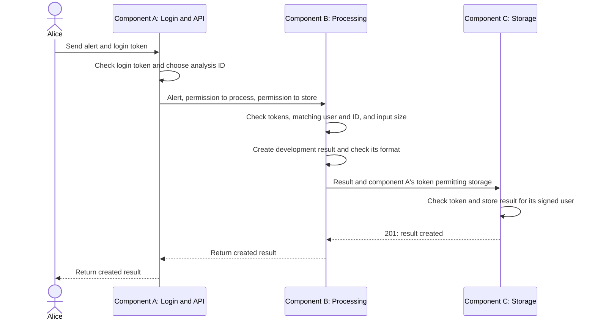

# Architecture and security design

Component A handles login and requests, component B processes alerts, and component C stores results.
This guide explains how they work together and where permissions are checked.
See [Verification](Verification.md) for test results and remaining work.

## Purpose and requirements

The application accepts a test alert from an intrusion detection system
(IDS), checks its contents, and stores a short analysis for the user who
submitted it. It uses invented test data.

Users send HTTP requests to an application programming interface (API).
There is no website with pages and buttons in this project. Registration
and a graphical interface were left out to keep the project small.

A *functional requirement* describes something the application must do.
A *non-functional requirement* describes how it should behave, for example
how it protects data or limits input size.

| What the application must do | How it does it |
|---|---|
| Check a user's login | Component A asks Django to check the username and password, then returns a signed login token. |
| Create an analysis using all three services | Component A sends the alert to component B. Component B processes it and sends the result to component C for storage. |
| List and read analyses | Ordinary users can access their own results. An administrator can access all results. |
| Restrict deletion | Only an administrator may delete an analysis. |

| Non-functional requirement | Control and limit |
|---|---|
| Confidentiality and permission integrity: protect private analyses and prevent unauthorized changes to token permissions. | Control: signed tokens identify the user and allowed action. Component C checks ownership and administrator access. Limit: local HTTP does not encrypt requests or responses. |
| Bounded processing input: reject alerts above the processing size limit. | Control: component B checks the alert's compact JSON encoded as UTF-8. Limits: 65,536 bytes for the alert and a separate Django request-body limit of 131,072 bytes. These size checks do not prevent repeated requests. |
| Repeatable setup: allow another developer to install and prepare the same application. | Control: requirements files specify package versions. The helper is installed as a wheel. Scripts prepare users and test data. Control in CI: `requirements-ci.txt` pins CI tools and their additional dependencies. The approval gate checks the full installed inventory. Limit: version checks do not verify package contents, and the basic local setup does not install every CI tool. |
| Safe handling of rejected requests: return clear errors for invalid or unauthorized requests. | Control: request handlers return HTTP 400, 401, 403, 404, or 413 for the corresponding error cases. Limit: the tests do not cover every possible invalid request or unexpected error. |
| Separate responsibilities: give each component a specific job and its own application permissions. | Control: component A, component B, and component C run separately. Component A and component C use different databases. Limit: all processes share one Windows account, so a compromised process may still access another component's files. |

See [Terminology](Terminology.md) for short explanations of technical words.

## Components and interfaces

A *process* is a running program. A *port* identifies a network listener on
the computer, and a *route* identifies an operation within that service.
For example, `http://127.0.0.1:8000/auth/token` sends a request to port
8000 and route `/auth/token`. Here, `127.0.0.1` means this computer.

| Service | Address and routes | What it does |
|---|---|---|
| Component A — application API | Port 8000, routes `/auth/token`, `/analyses`, `/analyses/{id}` | Checks logins using Django's user database, `.runtime/data/A/auth.sqlite`. Creates signed tokens and sends requests to component B or component C. |
| Component B — processing service | Port 8001, route `/internal/analyze` | Checks the alert and produces a fixed development result. Sends the result to component C together with a token that component A created to permit storage of that analysis. |
| Component C — storage service | Port 8002, routes `/internal/analyses`, `/internal/analyses/{id}` | Stores analyses in `.runtime/data/C/analyses.sqlite`. Checks the token and the user's permissions before allowing an operation. |

`{id}` is a placeholder for a specific analysis ID. The HTTP method also
matters: GET reads, POST creates, and DELETE deletes. A route containing
`internal` is intended for communication between services. That word
does not protect the route. Token and permission checks protect it.

All three services provide `/health` to show that they are running.
[urls.py](../app/urls.py) chooses routes according to the `SERVICE`
setting. The services use the same source files, but run in separate processes.
Their database files are storage, not additional application services.

The helper package, `alert-helper`, contains Python functions that check
alert and result data. It is built as a wheel, which is an installable Python
package file, and installed separately. Component B uses it when processing alerts.
The shared views also use its checks in component A and component C. It runs inside each service
that imports it, with that service's operating-system permissions.

## Create-analysis sequence

Consider Alice submitting an alert. Component A creates an analysis ID and two tokens:
one permits component B to process that alert. The other permits component C to store the result
for Alice under that ID. Both tokens are signed by component A.

Component B receives both tokens. It checks that they refer to the same user and
analysis. After processing, component B sends the result and the storage token to component C.
This is what “component B forwards a token” means: component B passes on component A's existing token.
Component B does not create or change it.

Listing, reading, and deleting use User → component A → component C. These requests do not need component B.

The caller waits while the services finish, so the workflow is *synchronous*.
There is no background queue. Network calls have time limits, but a timeout
does not undo a result that component C has already stored.

## Authentication and authority binding

*Authentication* checks who a user is. *Authorization* checks what that user
may do. *Authority* means the permission granted to a user or service.

At login, component A uses Django to check the password. The seeded `admin` account
has `is_staff=True`, which this application treats as the administrator role.

Component A then returns a JSON Web Token (JWT): a text token containing signed fields.
Those fields are called *claims*. [security.py](../app/security.py) uses
the existing RS256 signing algorithm. Component A signs with a private key. Services
check the signature with a public key. Signing lets them detect changes to
the claims. It does not encrypt their contents.

The token fields have these meanings:

| Field | Meaning in this project |
|---|---|
| `iss` — issuer | Who issued the token: `assignment-api`. |
| `aud` — audience | Which service may accept it: component A, component B, or component C. |
| `sub` — subject | The user ID represented by the token. |
| `scope` | The allowed action, such as `create` or `read`. |
| `role` | Ordinary user or administrator. |
| `analysis_id` | Which analysis the action concerns, where required. |
| `iat` | When the token was issued. |
| `exp` | When it expires. |
| `jti` | A unique identifier for the token. |

“Binding authority” means connecting permission to these specific values.
For example, a token for component C to create Alice's analysis is not permission
to delete a result or act for Bob.

Component A issues the following tokens:

| Token purpose | Service and allowed action | User and analysis restrictions | Valid for |
|---|---|---|---|
| User sends requests to component A | Component A, action `user` | Identifies the logged-in user and role. | 900 seconds |
| Component A asks component B to process an alert | Component B, action `execute` | Names the user and one analysis ID. | 600 seconds |
| Component A permits component C to store a result and component B passes this token to component C | Component C, action `create` | Names the same user and analysis ID as the processing token. | 600 seconds |
| Component A asks component C to list, read, or delete | Component C, the requested action | Identifies user/role. Read and delete also name one analysis ID. | 60 seconds |

The services check the signature, issuer, intended service, expiration,
required fields, action, and role. For read/delete, component C also checks that the
analysis ID in the URL matches the token. Component C stores the owner from the
verified `sub` field, rather than accepting an owner chosen in the request.

Tokens are sent using `Authorization: Bearer <token>`. “Bearer” names
the authentication scheme: someone holding a valid token can present it.

There is no system for cancelling a token before it expires or marking it
as already used. A unique `jti` does not by itself stop someone sending
the same token again. Component C does reject creation of a second record with the
same analysis ID.

## Access matrix

An access matrix lists who may perform each operation.

| Operation | Ordinary user | Administrator | Caller using the token that permits storage in component C |
|---|---|---|---|
| Ask component A to create an analysis | Yes | Yes | No |
| List or read results | Own results only | All results | No |
| Store the result in component C | Through component A → component B → component C | Through component A → component B → component C | Only for the user and ID named in that token |
| Delete a result | No | Yes | No |

Component A checks the administrator role before issuing permission to delete.
Component C checks that permission again. This protects component C even when it receives a
request directly rather than through component A.

[store.py](../app/store.py) checks ownership when reading and filters lists
by owner. Its SQL queries use parameters, so supplied values are treated as
data rather than SQL commands. The HTTP handler checks deletion permissions
before calling `store.delete()`. The database function itself has no role check.

## Input, output, and trust boundaries

The helper checks the alert's event type, timestamp with time zone, IP
addresses, protocol, signature text/ID, and severity. Optional network ports
must be integers from 0 to 65535. Extra alert fields are kept in the original
document but left out of the smaller input selected for processing.

Component B produces a `development-stub` result. A *stub* is a simple replacement
used during development: this one builds a fixed-format summary rather than
calling a real AI model.

The result must contain text fields for observation, interpretation, and
uncertainty, plus nonempty lists of recommended actions and evidence fields.
The evidence fields must refer to fields in the selected alert. These
*schema checks* check the structure. They do not prove the explanation is true.
Component C stores the original alert, selected fields, result, model information,
creation time, and processing duration.

A *trust boundary* is a point where one component receives data or requests
from another source and must check them. The boundaries are between the client and component A, between component A
and component B, between component A and component C, and between component B
and component C. Installing the helper introduces another trust decision:
its Python code runs inside the service that imports it.

## Assets and STRIDE

An *asset* is something that needs protection. The asset register lists
those items and their protection needs.

| Asset | Where it is stored or used | Protection needed |
|---|---|---|
| User accounts, password hashes, and roles | Component A's Django database | Check passwords and control who can become an administrator. |
| Alerts and analysis results | User-owned records in component C's database | Prevent unauthorized reads, changes of owner, and deletion. |
| Private signing key | Component A's configured key file | Prevent others from issuing accepted tokens. |
| Tokens passed between services | Client and component A, component B, and component C requests | Limit each token to the intended service, action, user, analysis, and time. |
| Processing capacity | Component B's process | Limit input size. Request-rate limits are still needed. |
| Helper and other installed packages | Python environment | Review packages and versions. The CI approval gate rejects an installed package or version outside the approved lists. |
| Test results and release decisions | Reports, Jenkinsfile, Git history | Keep accurate results and make required failures stop a release. |

STRIDE is a checklist of six types of security threats:

| Threat type | What could go wrong here | Current protection | Remaining limitation |
|---|---|---|---|
| Spoofing — pretending to be someone else | An attacker presents false user/service permission. | Signed tokens and claim checks. | A stolen token can be used until it expires. |
| Tampering — changing data | A caller changes ownership or makes input change an SQL query. | Owner from signed token, parameterized SQL, document checks. | Correct structure does not prove a result is factually correct. |
| Repudiation — denying an action | A user denies performing an operation. | Ordinary server and test output. | No dedicated audit history proving who did what. |
| Information disclosure — exposing private data | Bob reads Alice's analysis. | Component C's ownership checks and filtered lists. | Processes share the same Windows account and may access the same files. |
| Denial of service — preventing normal use | Large or repeated requests consume capacity. | Size limits and network timeouts. | No rate limits or measured resource-exhaustion experiment. |
| Elevation of privilege — gaining extra permission | A user deletes without being an administrator. | Checks of service, action, role, and analysis ID. | Anyone obtaining component A's private key could issue accepted tokens. |

Only component A is configured with the private-key path. However, all local processes
run under the same OS user. Windows may therefore let a compromised component B process
read component A's key or component C's database directly. A *sandbox* would restrict this through
operating-system permissions or similar isolation. Separate processes alone
do not provide that restriction. The optional Compose configuration uses
different mounts. It has passed a local functional smoke test, but that test
did not assess whether a compromised container could escape its intended
permissions or access another component's mounted data.

## Secure design principles

| Principle | Meaning and implementation | Test or other evidence |
|---|---|---|
| Complete mediation | Check permission every time a protected operation is requested. Component C checks tokens and resource permissions even for requests from another service. | `test_create_read_cross_user_and_admin`, `test_list_only_owned`, direct requests to component C in deletion tests. |
| Least privilege | Give only the permission needed for the task. Component B receives tokens for one analysis. Permission to create in component C cannot be used to delete. | `test_b_authority_cannot_delete` expects 403 and checks that the record still exists. |
| Fail-safe defaults | Reject requests unless they meet the rules. Invalid tokens and unexpected request fields are denied. | Forged/expired/wrong-service token tests and the untrusted-owner-field test. |

The tests are in [test_flow.py](../tests/test_flow.py) and
[test_store_sql.py](../tests/test_store_sql.py).
[Verification](Verification.md) describes their coverage and limits.

## Experiments and scope

The runnable `vulnerable-version` deliberately enables CWE-20, CWE-862,
CWE-89, and the additional composition flaw, CWE-807. A CWE number names a
category of software weakness. Its HTTP suite shows four expected failures,
and its direct SQL regression also fails. The fixed comparison passes all ten
HTTP tests and the direct SQL regression.
The [experiment guide](Vulnerability_Experiments_Guide.md) explains each one.

The composition flaw occurs when component C trusts a body field saying who owns the
result, even though component A's signed token already identifies the authorized user.
The test simulates component B having valid permission to create Alice's result and
then trying to store it for Bob.

The CWE-89 HTTP experiment sends an injected analysis ID through component A.
The vulnerable branch omits the UUID-format check for GET requests so the
payload reaches its deliberately unsafe query. The corrected branches keep
the format check and use a parameterized query. The test requests Alice's own
record, which isolates SQL behavior from the separate ownership experiment.

The combined vulnerable comparison also disables read ownership checks.
Its later read alone cannot distinguish the two ownership flaws. The
[isolated composition experiment](Composition_Isolation.md) keeps those read
checks active. Bob is denied access to Alice's ordinary record, but can read
the new record incorrectly stored for him using Alice's create permission.
Alice cannot read that new record. This shows the ownership error at creation
while the normal owner-based read rule continues to work.

Separate local processes are sufficient for the assignment. Remaining CI
work is listed in [Verification](Verification.md).

## Production release and operation

Before offering the application as a production service, it would need:

- Encrypted connections using TLS, a production application server, and
  suitable network restrictions.
- Separate service accounts and file permissions so component B cannot read component A's
  private key or component C's database.
- A plan for replacing signing keys, cancelling stolen credentials, and
  handling repeated use of tokens.
- Request-rate limits, capacity controls, and a decision about retries.
  Repeating a request after a timeout should not accidentally duplicate work.
- Audit logs, monitoring, backups, data-retention rules, and recovery tests.
- Evaluation of a real processing model if the development stub is replaced.

These production features are not implemented.
