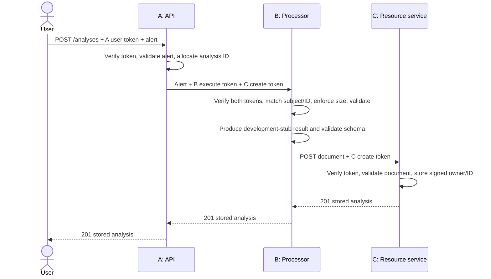

# Architecture and security design

This document describes the current prototype. Historical planning is
preserved in commit `8e1b610`; current test evidence and gaps are in
[Verification](Verification.md).

## Purpose and requirements

The application validates a synthetic IDS alert, produces a labelled
development summary, and stores it as a user-owned analysis. It is an API;
account registration and a graphical interface are outside the chosen scope.

| Functional requirement | Implementation |
|---|---|
| Authenticate seeded users | A uses Django authentication and returns a signed JWT. |
| Create an analysis through three components | A delegates to B; B validates/processes and submits to C. |
| List/read protected results | A forwards scoped authority to C; ordinary users see their own results, admins may see all. |
| Restricted operation | Only an administrator may delete a result. |

| Non-functional requirement | Control and limit |
|---|---|
| Confidentiality and authority integrity | Signed tokens and C's ownership checks; transport remains local HTTP. |
| Bounded processing input | B limits compact UTF-8 alert JSON to 65,536 bytes; Django's request-body limit is 131,072 bytes. |
| Repeatable setup | Requirements files, installable helper wheel, seed script, fresh test state; CI tooling and some resolved dependencies are not fully pinned. |
| Safe handling of rejected requests | Explicit 400/401/403/404/413 responses for covered cases; negative-path coverage is not exhaustive. |
| Separate responsibilities | Three HTTP processes with separate A/C databases; shared local OS user is not a sandbox. |

## Components and interfaces

| Component | Process and routes | Data and authority |
|---|---|---|
| A — application API | Port 8000; `/auth/token`, `/analyses`, `/analyses/{id}` | Django users in `.runtime/data/A/auth.sqlite`; signs tokens. |
| B — processing | Port 8001; `/internal/analyze` | Validates the assigned alert, builds a stub result, forwards a limited C create token. |
| C — resource service | Port 8002; `/internal/analyses`, `/internal/analyses/{id}` | Owns `.runtime/data/C/analyses.sqlite`; verifies authority and enforces resource access. |

All processes expose `/health`. The routes are selected by `SERVICE` in
[urls.py](../app/urls.py). A and C's databases are storage, not extra
application components. The same installed code is used by all processes.

The helper `alert-helper` is a separately built/installed Python wheel, not
a fourth process. B uses it during processing; A and C also use its validators
through the shared views. It executes with its importing process's permissions.

## Create-analysis sequence

List/read/delete follow User → A → C, with responses returning through A.
All operations are synchronous. There is no job queue or job-status API.
Inter-service requests use connect/read timeouts; an error or timeout does
not guarantee rollback of work already completed downstream.

## Authentication and authority binding

A uses Django's seeded accounts and password authentication. The `admin`
account has `is_staff=True`, which A maps to the application role `admin`.
There is no custom cryptographic algorithm.

[security.py](../app/security.py) issues RS256 JWTs and fixes RS256 during
verification. It validates issuer `assignment-api`, signature, audience,
required claims, expiry, scope, and allowed role. The views enforce
resource-specific checks. Username/password authentication occurs at login;
later requests present bearer tokens.

| Authority | Audience and scope | Resource/identity binding | Lifetime issued by A |
|---|---|---|---|
| Client token | `A`, `user` | Signed user `sub` and role | 900 seconds |
| B execution | `B`, `execute` | Signed `sub` and newly allocated `analysis_id` | 600 seconds |
| C create carried by B | `C`, `create` | Same `sub` and ID as B execution | 600 seconds |
| C list/read/delete | `C`, corresponding action | Signed `sub`/role; read/delete additionally bind the requested ID | 60 seconds |

B verifies that the execute and create tokens name the same user and analysis.
C derives the stored owner from `sub` and the ID from `analysis_id`.
C checks the URL ID against the claim on read/delete and uses owner/admin
checks for access. List operations filter by owner unless the role is admin.

A generates `iat`, `exp`, and `jti`. There is no token revocation or
single-use-token registry: `jti` alone does not stop replay. C's primary key
rejects a duplicate create ID.

## Access matrix

| Operation | Ordinary user | Administrator | B's C create token |
|---|---|---|---|
| Request analysis through A | Yes | Yes | No |
| List/read results | Own | All | No |
| Create stored result | Through A → B | Through A → B | Assigned ID and owner only |
| Delete result | No | Yes | No |

A checks admin status before issuing delete authority. C independently checks
the delete scope, resource claim, and admin role. [store.py](../app/store.py)
uses parameterized queries; read ownership is checked there and listing is
filtered there. Deletion's role/resource checks are in C's view, not inside
`store.delete()`.

## Input, output, and trust boundaries

The helper accepts an alert with `event_type=alert`, timezone-aware timestamp,
valid IP addresses, nonblank protocol/signature, positive signature ID, and
severity 1–3. Optional ports must be integers 0–65535. Extra alert fields are
retained in the original document but excluded from the selected processing
input.

The result schema requires nonblank observation, interpretation, and
uncertainty; nonempty lists of recommended actions and evidence fields; and
evidence field names present in the selected alert. Schema checks do not prove
semantic correctness. C stores ID and owner columns plus a JSON document
containing original/selected input, model/prompt/settings metadata, timestamp,
latency, and result.

Trust boundaries are client–A, A–B, A–C, and B–C. The installed helper is a
code/dependency trust boundary inside each consuming process. Stub output is
validated before storage; there is no external model boundary in the running
prototype.

## Assets and STRIDE

| Threat | Asset | Control | Residual limit |
|---|---|---|---|
| Spoofing | User/service authority, tokens | RS256 signature and claims checks | Stolen bearer tokens are usable until expiry. |
| Tampering | Ownership, queries, results | Signed owner/ID, parameterized SQL, document validation | Authorized content is not guaranteed to be factually correct. |
| Repudiation | Record of actions | Ordinary server/test output | No dedicated audit trail or non-repudiation guarantee. |
| Information disclosure | Per-user analyses | C's owner/admin enforcement and own-only lists | Local processes share OS-level file access. |
| Denial of service | Processing/storage capacity | Size checks and request timeouts | No rate limits or general DoS guarantee; no measured resource-exhaustion experiment. |
| Elevation of privilege | Admin/service authority | Scope, role, audience, and resource checks | Compromise of A's signing key compromises authority. |

Only A is configured with a private-key path. All local processes run as the
same OS user and can potentially access the same files. Compose declares
separate key/database mounts but has not been runtime-verified. Do not claim
that the local configuration contains arbitrary malicious package execution.

## Secure design principles

| Principle | Design decision and implementation | Test/evidence |
|---|---|---|
| Complete mediation | C verifies each protected HTTP operation and applies owner/admin checks even for service requests. | `test_create_read_cross_user_and_admin`, `test_list_only_owned`, and direct-C deletion checks. |
| Least privilege | B receives execute/create authority for one ID/user; create authority cannot delete. | `test_b_authority_cannot_delete` expects 403 and verifies the record remains. |
| Fail-safe defaults | Missing/invalid authority is denied; request fields are allowlisted. | `test_forged_token`, `test_expired_and_wrong_audience`, `test_untrusted_owner_field_cannot_change_owner`. |

These tests are in [test_flow.py](../tests/test_flow.py). A separate
[SQL test](../tests/test_store_sql.py) checks parameterization directly.
[Verification](Verification.md) distinguishes tested cases from untested paths.

## Experiments and scope

CWE-20, CWE-862, and CWE-89 have vulnerable/corrected logs. The cited CWE-862/
CWE-89 snapshots need repair for reproducibility, as recorded in Verification.
Composition/CWE-807
has an implemented corrected control and commented variant, but its vulnerable
evidence needs to be rerun successfully. See the
[experiment guide](Vulnerability_Experiments_Guide.md).

The supplied assignment requires neither Ollama nor containers specifically.
The chosen stub and separate-process execution meet those technology choices;
they do not establish completion of the remaining experiment/CI requirements.
Production operation would require transport security, stronger host isolation,
key lifecycle management, audit/monitoring, backup/retention, and appropriate
evaluation of any real analysis model.
